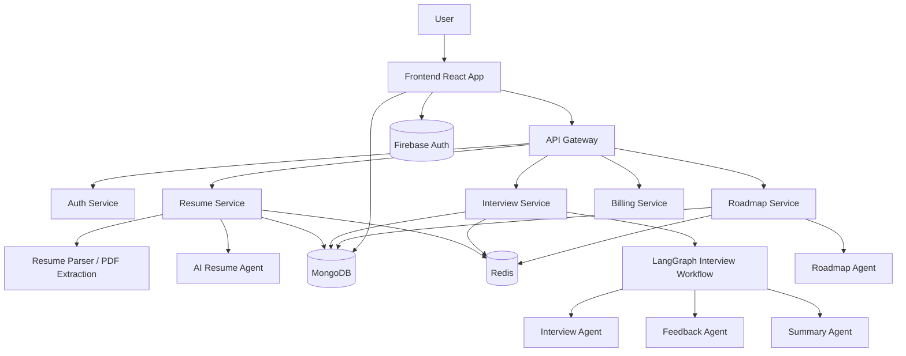
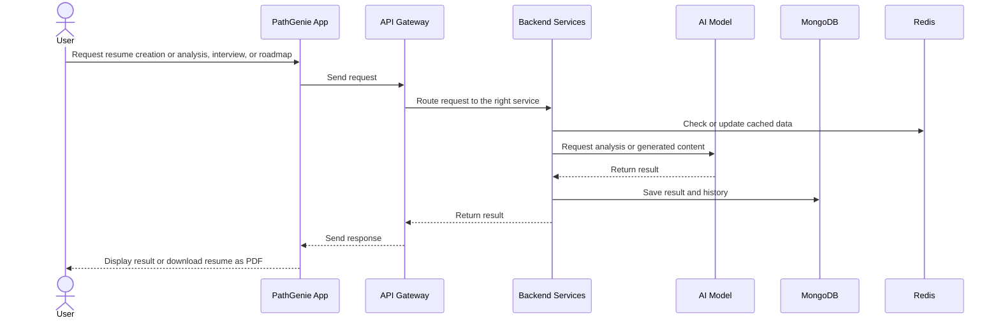

# PathGenie

From uncertainty to job-ready confidence, driven by AI.

**URL:** [PathGenie](https://dq9ly20ppfwb8.cloudfront.net/)

## 1. Project Name

PathGenie

## 2. Problem Statement

Fresh graduates often struggle to convert theoretical knowledge into interview-ready skills. They face multiple challenges at the same time:

- Lack of realistic mock interviews tailored to their target role
- Unclear understanding of how recruiters evaluate resumes and technical answers
- Weak feedback loops after practice interviews
- No personalized roadmap to improve skills for a specific job profile or salary target
- Limited access to affordable, structured interview coaching and career guidance

Most existing tools are either generic, expensive, or not tailored to Indian fresher hiring patterns. There is a clear gap between classroom learning and actual hiring expectations.

## 3. Project Overview

PathGenie is an AI-powered platform that helps freshers prepare for jobs through resume creation and analysis, role-based mock interviews, and personalized learning roadmaps. Users can create and download a tailored resume, practice technical or HR interviews, receive feedback, and follow a role-specific learning path.

The platform combines AI-driven services to analyze resumes, simulate interviews, evaluate responses, and recommend a path toward role-specific improvement.

## 4. Implemented Platform

PathGenie is an implemented AI-powered career-preparation platform. Users can:

- Build and preview a resume, then download it as a PDF
- Upload a resume PDF for text extraction and AI-powered analysis
- Start role-based HR or technical mock interviews with generated questions
- Submit answers and receive feedback as the interview progresses
- Review completed interviews, including scores, strengths, weaknesses, and recommendations
- Generate and revisit learning roadmaps based on a target role, package, and optional resume context

The backend uses dedicated AI workflows for resume analysis, interview questions and feedback, interview summaries, and roadmap generation.

## 5. Product Outcomes

The implemented product supports the following user journeys:

1. Practice HR and technical interviews tailored to a selected role.
2. Receive answer-level feedback and a final interview report.
3. Analyze an uploaded resume and review structured recommendations.
4. Create a learning roadmap aligned with a target role and package.
5. Access saved resumes, interview history, and roadmaps through an authenticated account.

## 6. Target Users / Use Case

### Primary Target Users

- College students preparing for campus placements
- Fresh graduates applying for software roles
- Career switchers entering tech-related job markets
- Students needing structured interview preparation and role guidance

### Use Cases

- A fresher wants to practice a technical interview for a backend engineer role.
- A student uploads a resume and wants AI to identify missing skills and weak sections.
- A user wants a roadmap to reach a target package such as 20 LPA or 30 LPA.
- A candidate wants detailed feedback after answering interview questions.

## 7. AI and Data Technologies

The implemented AI workflows and supporting services use:

- `openai/gpt-oss-120b`, accessed through the Groq API
- LangChain for prompting and LLM orchestration
- LangGraph for multi-step agent workflows and graph-based execution
- Redis for session and response caching
- MongoDB for user, resume, interview, roadmap, and billing records
- Firebase Authentication for login and user state management

These components are integrated into the running application and its backend services.

## 8. Why This Technology Was Selected

### `openai/gpt-oss-120b` through Groq

The application uses this model for:

- generating role-specific interview questions
- evaluating answers with feedback
- creating summary reports and recommendations
- generating a tailored learning roadmap

### LangChain + LangGraph

These frameworks coordinate multi-step workflows, including:

- interview initiation
- answer evaluation
- completion detection
- summary generation
- roadmap generation

### Redis and MongoDB

- Redis caches sessions and selected user data to reduce repeated database queries.
- MongoDB persists structured records such as resume analysis, interview history, and roadmaps.

## 9. AI's Role in the System

AI is integrated into the core product workflows:

AI responsibilities include:

- Parsing resume content and identifying strengths, missing skills, and ATS gaps
- Generating well-structured role-specific interview questions
- Evaluating candidate responses against expected quality, clarity, and technical depth
- Producing performance summaries and improvement suggestions
- Personalizing a career roadmap based on role, package target, and resume data

The generated feedback and plans are presented as structured coaching guidance within the application.

## 10. System Architecture

## 11. Component-Level Architecture

### Frontend

- Built using React + Vite
- Handles dashboard, login, resume management, interview workflows, roadmap generation, and billing screens
- Provides responsive UI for freshers and career prep tasks

### Backend Gateway

- Central entry point for routing traffic across services
- Provides a unified API layer and request forwarding

### Auth Service

- Manages login/logout
- Integrates with Firebase authentication
- Stores user-specific context and session state

### Resume Service

- Creates ATS-friendly resumes from user-provided information and provides PDF download
- Accepts uploaded resume PDFs
- Extracts text from PDF files
- Sends parsed resume content to the AI model
- Saves structured resume skills and recommendations to MongoDB

### Interview Service

- Starts interview sessions
- Generates HR/technical interview questions based on role and type
- Stores answers and progress
- Evaluates each response
- Produces final summary, strengths, weaknesses, and recommendations

### Roadmap Service

- Accepts role and package target
- Uses resume context and role information to generate a detailed learning roadmap
- Stores results for user access and history

### Billing Service

- Handles premium/digital usage-related flows such as coin-based or subscription-related operations

## 12. Data / Information Flow

## 13. Agentic Workflow

The project follows a multi-agent workflow pattern where each AI agent is responsible for a dedicated part of the journey.

### Interview Workflow

1. User selects interview type and role.
2. Interview service triggers the interview agent.
3. AI generates a list of relevant questions.
4. User answers each question one by one.
5. Feedback agent evaluates the answer.
6. If the interview is complete, summary agent creates a final performance report.
7. Results are stored for dashboard analytics and future review.

### Roadmap Workflow

1. User enters target role and package goal.
2. Roadmap service uses role context and optional resume context.
3. AI generates a plan covering learning priorities, milestones, and next steps.
4. The system stores the roadmap and shows it in a structured format.

## 14. Technology Stack

| Layer | Technology |
|---|---|
| Frontend | React, Vite, Tailwind CSS, Redux |
| Routing and UI | React Router, Framer Motion |
| Backend API | Node.js, Express |
| AI orchestration | LangChain, LangGraph |
| LLM access | Groq API with `openai/gpt-oss-120b` |
| Database | MongoDB |
| Caching and sessions | Redis |
| Authentication | Firebase Auth / Firebase Admin |
| Resume processing | PDF text extraction utilities |
| Payments | Razorpay |
| Containerization support | Docker |

## 15. Deployment

PathGenie is deployed on AWS using the following services:

| AWS technology | Purpose |
|---|---|
| Amazon CloudFront | Delivers the frontend to users |
| Amazon ECS | Runs the containerized gateway and backend services |
| Amazon ECR | Stores the Docker images used by ECS |
| Application Load Balancer | Routes incoming requests to the gateway |
| Amazon ElastiCache for Redis | Provides the backend cache |
| Amazon VPC and security groups | Isolate services and control network access |

## 16. Implemented Features

- Resume builder with preview and PDF download
- Resume PDF upload, text extraction, AI analysis, and saved recommendations
- HR and technical mock interview workflows with generated questions
- Answer submission, per-answer feedback, interview completion, and final reports
- Interview history and dashboard performance metrics
- Personalized roadmaps using a target role, package, and optional resume data
- Authenticated user sessions and user-scoped data
- Billing and payment workflows using Razorpay

## 17. Backend API

The Express API gateway authenticates requests and routes them to the backend services. Implemented product routes include:

- **Resume:** `POST /api/resume/upload`, `GET /api/resume/get-resume`
- **Interview:** `POST /api/interview/start`, `POST /api/interview/answer`, `GET /api/interview/all`, `GET /api/interview/:id`
- **Roadmap:** `POST /api/roadmap/generate`, `GET /api/roadmap/all`, `GET /api/roadmap/:id`

The gateway also routes authentication and billing requests to their respective services.

## 18. Architecture and Services

The application is organized as a React frontend and Node.js/Express backend services:

- **API gateway:** Authenticates and routes requests to downstream services.
- **Auth service:** Handles Firebase-backed authentication and user sessions.
- **Resume service:** Extracts PDF text, runs resume analysis, and stores results.
- **Interview service:** Runs question generation, answer feedback, and report workflows.
- **Roadmap service:** Generates and stores role- and package-oriented learning plans.
- **Billing service:** Supports payment flows through Razorpay.

MongoDB is used for persistent application data, while Redis supports session and data caching.

## 19. Future Enhancements

Potential additions beyond the current feature set include:

- coding interview simulations with live code execution
- voice-based interview practice
- domain-specific interview modes such as DSA, frontend, backend, DevOps, and data roles
- multi-language support
- recruiter feedback simulator
- AI-generated portfolio suggestions and project recommendations
- recommendation engine for learning resources and internships

## 20. Engineering Considerations

The implemented workflows account for several practical constraints:

- **Variable AI output:** Prompts and graph-based workflows structure generated questions, feedback, and roadmaps.
- **Resume format differences:** Uploaded PDFs are processed through a text-extraction step before analysis.
- **User data access:** Authenticated requests are forwarded through the gateway, and user-specific records are queried by user ID.
- **Repeated reads:** Redis caches sessions and selected records, with cache invalidation on relevant updates.

## Summary

PathGenie is an implemented AI-assisted career-preparation platform for resume building and analysis, mock interviews, and personalized learning roadmaps. Its React frontend, authenticated API gateway, and dedicated backend services connect AI workflows with persistent user data and payment capabilities.